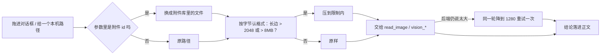

<div align="center">

# dsh-auto-convert

**让 DeepSeek Harness 在动手之前，就把图处理成自己能读的样子**

[](https://github.com/yimengsuper2432/dsh-auto-convert)
[](https://github.com/deepseek-ai/deepseek-harness)
[](./LICENSE)

</div>

`dsh-auto-convert` 是 DeepSeek Harness 的一个宿主插件，专门修「图看不懂」这件事：图太大、格式太怪、名字和里子对不上，它都在工具真正去读之前处理好，而不是把报错丢回给你、让你再补一句「帮我压一下」。

它适合这样的用法：手机拍的、截图工具存的、从网页另存的图，随手拖进对话框就行——不管是四千像素的原片，还是一张被改过后缀的 WebP，都不用先自己开画图软件转一遍。

## 为什么需要它

DSH 读图有两条硬门槛，撞上哪条都只能说「这张我看不了」：

| 报错 | 真正的原因 |
| --- | --- |
| 图太大 / 视觉后端超时 | 长边几千像素，远超视觉模型的负载上限 |
| 仅支持 PNG、JPG、WebP、GIF 格式的图片 | 上传时标的类型和真实字节对不上（`IMAGE_TYPE_MISMATCH`），或者格式根本不在这四类里 |

第一条压一压就好，第二条要看是真不支持、还是只是名字写错了。

## 它做什么

### 1. 交出去之前先降一档

`read_image`、`vision_*` 拿到本机路径时，插件先看长边和体积：超过 **2048 px** 或 **8 MB** 就先压到限制内，再交给工具。工具本身不知道这件事发生过，它只是收到一个更小的同格式文件。

### 2. 同一轮里自动重试

压过之后后端还是说太大，插件会在**同一个回合内**再降一档到 **1280 px** 重来一次。不用你再补一句「再压小点」。

### 3. 聊天附件先落地成文件

你在对话框里拖进来的图，模型那边看到的只是 `sha256:…` 这种 id，给不了工具一份真实路径。插件把它换成附件库里的实际文件，再走上面两步，所以「发来一张四千像素的图，这一轮就认出来」是能成立的。

### 4. 上传那道门也包住了

附件入库前，插件按**字节**（而不是扩展名）判断真实格式：

- 真身是 PNG / JPEG / GIF / WebP，只是名字标错了 → **只改类型标签**，一个字节都不动；
- 真身是 BMP / TIFF → 就地转成 PNG 再入库；
- 认不出来、或者解不开（HEIC / AVIF / PSD / RAW / SVG）→ 原样放行，不拦也不报错。

于是「明明格式是对的却传不上去」这种事，不会再变成你要改文件名、重新导出。

### 5. 不需要的时候什么都不做

已经在限制内的、格式本来就对的图，走原路：不多一次读写，也不多一份临时文件。

## 一轮里发生什么



## 安装

> 需要 DeepSeek Harness `0.2.0` 或更新版本。仓库里没有构建产物，装完即可用。

### 桌面端

打开 **插件 → 添加插件**，填入仓库地址，安装后**重启一次桌面端**（宿主插件只有重启才会加载）：

```text
https://github.com/yimengsuper2432/dsh-auto-convert.git
```

### Web / CLI

```bash
dsh plugin --profile desktop add github:yimengsuper2432/dsh-auto-convert
```

装完不用任何设置，插件默认全开。

## 配置

没有设置页，也没有配置文件。要改就改 `lib/index.js` 顶部这几个常量：

| 常量 | 默认 | 含义 |
| --- | --- | --- |
| `MAX_SIDE` | `2048` | 长边超过这个像素就降采样 |
| `MAX_BYTES` | `8 * 1024 * 1024` | 体积超过这个值也降采样 |
| `RETRY_SIDE` | `1280` | 同一轮重试时用的长边 |
| `SUPPORTED` | png / jpeg / gif / webp | 宿主接受的四种格式 |
| `CONVERTIBLE` | bmp / tiff | 能就地转成 PNG 的格式 |

降采样用的是宿主 profile 里已经装好的 `jimp`，不额外下载解码器。

## 已知天花板

- **GIF 只剩第一帧**：走 jimp 压过的动图会变成静图；不压的时候原样不动。
- **HEIC / AVIF 还是读不了**：这两种要靠 `sharp` 或 `libheif`，仓库里没带，所以插件对它们只做到「不拦、不报错」，读不读得出来还是看后端。
- **改名型 WebP 只改标签**：宿主接受 WebP，所以不做转码；如果你的视觉后端不认 WebP，得自己转一份 PNG。
- **本来就合规的图不动**：不会为了整齐去重编码一遍。
- **临时文件不主动清理**：压过的副本落在系统临时目录里，交给操作系统回收。

## 开发

```bash
node test.mjs
```

自检覆盖字节嗅探、降采样、同一轮重试、附件 id 落地、格式转换和上传入库前的那层包装，跑完打印 `all good`。

## License

[MIT](./LICENSE)
