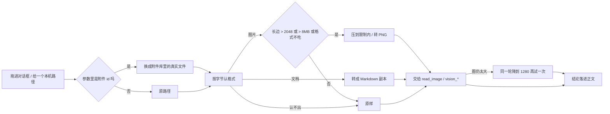

<div align="center">

# dsh-auto-convert

**让 DeepSeek Harness 在动手之前，就把文件处理成自己能读的样子**

[](LICENSE)
[](https://github.com/deepseek-ai/deepseek-harness)

图太大就压小，格式怪就转掉，文档干脆变成 Markdown —— 全都发生在 `read_image`、`vision_*`、`read` 真正拿到文件之前。

</div>

`dsh-auto-convert` 是 DeepSeek Harness 的宿主插件。它不提供新命令，也不要求你换一种用法：手机拍的图、截图工具存的图、改过后缀的图，随手拖进对话框；Word 报告、Excel 台账、PPT 讲稿、PDF 论文，直接拖进来问。**图能在这一轮被看见，文档能在这一轮被读懂**——不用先自己开软件转一遍，也不用再补一句「帮我压一下」。

## 为什么需要它

DSH 读文件有三条硬门槛，撞上哪条都只能说「这个我看不了」：

| 报错 / 现象 | 真正的原因 |
| --- | --- |
| 图太大 / 视觉后端超时 | 长边几千像素，远超视觉模型的负载上限 |
| 仅支持 PNG、JPG、WebP、GIF 格式的图片 | 上传时标的类型和真实字节对不上（`IMAGE_TYPE_MISMATCH`），或者格式根本不在这四类里 |
| 读文件报 `binary file` / 一屏乱码 | docx、xlsx、pptx、pdf 是二进制容器，`read` 把它们当文本只会读出噪声 |

第一条压一压就好，第二条要看是真不支持、还是只是名字写错了，第三条要先把文档拆成文字。

## 支持格式与处理链路

### 图片

| 输入 | 什么时候动手 | 输出 |
| --- | --- | --- |
| PNG / JPEG / GIF / WebP | 长边 > **2048 px** 或体积 > **8 MB** | 缩到 2048 px 以内：无透明通道 → JPG（q88），有透明通道 → PNG |
| BMP / TIFF | **一律**（读图工具不吃这两种） | PNG |
| HEIC / AVIF / PSD / RAW / SVG | 不动 | 原样放行，让工具报它自己的错 |
| 本来就合规的小图 | 不动 | 原文件，不重编码、不产生副本 |

还有一条只改标签的路径：真身是 PNG / JPEG / GIF / WebP、只是扩展名或 MIME 标错了（`.png` 里装 WebP 就是这么被打回的），**只改类型标签，一个字节都不动**。

### 文档

| 输入 | 输出 | 保留什么 |
| --- | --- | --- |
| `.docx` | Markdown | 标题层级、段落、列表、表格（管道表格） |
| `.xlsx` | Markdown | 每张工作表一张表，按 `workbook.xml` 的顺序 |
| `.pptx` | Markdown | 一页一个二级标题，页面文字与表格 |
| `.pdf`（有文字层） | Markdown | 正文文字，按行还原 |
| `.csv` / `.tsv` | Markdown | 管道表格 |
| `.html` / `.htm` | Markdown | 标题、列表、链接、粗斜体、表格 |
| `.doc` / `.xls` / `.ppt`、扫描件 PDF | 不动 | 老二进制格式要 Office/LibreOffice，扫描件要 OCR，都不在本插件里 |

> 图片、图表、公式这些**非文字内容**不提取：转换只负责把文字与结构搬过去。Markdown 本身也表达不了字体、字号、颜色。

## 一轮里发生什么



## 它是怎么做到的

1. **挂的是宿主 `tools/execute` 环绕钩子**，不是某个具体工具。`read`、`read_image`、`vision_*` 和 `run_code` 里的子调用都走同一条路，一处修好全覆盖；工具本身不知道文件被换过，它只收到一个更小、或者已经是 Markdown 的副本。
2. **按字节认格式**（PNG / JPEG / GIF / WebP / BMP / TIFF / PDF / OOXML zip），不看扩展名——改过名的图也认得出；认不出的直接放行，不猜、不拦。
3. **递归扫参数里的绝对路径**（对象/数组最多 5 层、一次最多 8 个文件），只处理存在、非空、真的是图的文件；`attachmentIds: ["sha256:…"]` 先换成附件库里的真实文件再走同一流程。
4. **图片降采样**用 profile 里已经装好的 `jimp`，等比缩放，产物按「源文件 + mtime + 目标长边」缓存在系统临时目录。
5. **文档转换是零依赖的**：OOXML 就是 zip，用 `node:zlib` 解开后按 `document.xml` / `sheet*.xml` / `slide*.xml` 取结构；PDF 只捞文字层，遇到 CID 字体就解析 ToUnicode CMap 把字形码位还原成文字。不联网、不装 Python、不调 Office。
6. **同一轮自动重试**：只对「压过图、后端还是说太大」的 `read_image` / `vision_*` 生效，用 1280 px 再跑一次。文档不重试，读不出来就原样报错。
7. **上传那道门也包住了**：附件入库前按字节核对类型，标签错的改标签、BMP / TIFF 就地转 PNG、解不开的原样放行。

## 安装

> 需要 DeepSeek Harness `0.2.0` 或更新版本。仓库里没有构建产物，装完即可用。

### 桌面端

打开 **插件 → 添加插件**，填入仓库地址，安装后**重启一次桌面端**（宿主插件只有重启才会加载）：

```text
https://github.com/yimengsuper2432/dsh-auto-convert.git
```

### Web / CLI

```bash
dsh plugin --profile desktop add github:yimengsuper2432/dsh-auto-convert
```

装完不用任何设置，插件默认全开。

## 配置

没有设置页，也没有配置文件。要改就改 `lib/index.js` 顶部这几个常量：

| 常量 | 默认 | 含义 |
| --- | --- | --- |
| `MAX_SIDE` | `2048` | 长边超过这个像素就降采样 |
| `MAX_BYTES` | `8 * 1024 * 1024` | 体积超过这个值也降采样 |
| `RETRY_SIDE` | `1280` | 同一轮重试时用的长边 |
| `SUPPORTED` | png / jpeg / gif / webp | 宿主接受的四种图片格式 |
| `CONVERTIBLE` | bmp / tiff | 能就地转成 PNG 的格式 |
| `DOC_EXT` | docx / xlsx / pptx / pdf / csv / tsv / htm / html | 能转成 Markdown 的文档 |

单个文档最多输出 40 万字符（`lib/docs.js` 的 `MAX_MD`），xlsx 单表最多前 500 行，超出会截断并在文件里留说明。

## 已知天花板

- **GIF 只剩第一帧**：走 jimp 压过的动图会变成静图；不压的时候原样不动。
- **HEIC / AVIF 还是读不了**：这两种要靠 `sharp` 或 `libheif`，仓库里没带，所以插件对它们只做到「不拦、不报错」。
- **改名型 WebP 只改标签**：宿主接受 WebP，所以不做转码；视觉后端不认 WebP 得自己转一份 PNG。
- **扫描件 PDF 不 OCR**：没有文字层的 PDF 转不出内容，插件会放行原文；要 OCR 得上专用插件。
- **老 Office 二进制（.doc/.xls/.ppt）不支持**：那是 OLE2 复合文档，纯 Node 解不干净，交给工具自己报错。
- **只搬文字与结构**：docx 里的图片、PDF 里的图表、公式都不会提取。
- **临时文件不主动清理**：压过的图和转好的 Markdown 落在系统临时目录里，交给操作系统回收。

## 开发

```bash
node test.mjs
```

自检覆盖字节嗅探、降采样、同一轮重试、附件 id 落地、格式转换、上传入库前的那层包装，以及 docx / csv / html 的转 Markdown 与缓存；跑完打印 `all good`。

## License

[MIT](LICENSE)